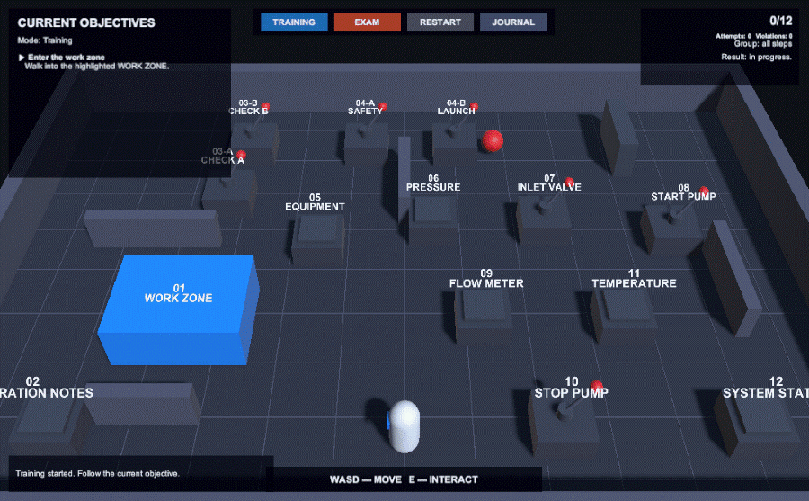

# Конструктор учебных сценариев для Unity

Конфигурируемая система учебных сценариев для Unity, рассчитанная на сборку и изменение сценариев через Editor без правок игрового кода. Один каталог шагов переиспользуется в режимах обучения и экзамена, а порядок, параллельность, группы, обработка ошибок, начисление баллов, журналирование и анализ результата задаются отдельными `ScriptableObject`-конфигурациями.

Проект подготовлен для **Unity 6.3 LTS (6000.3.7f1)**.



## Что реализовано

- переиспользуемые шаги с постоянным ID, названием, инструкцией и правилом выполнения;
- источники действий `UI Button`, `Trigger`, `Collision`, `UnityEvent` и общий контракт для собственных источников;
- последовательная, параллельная и смешанная активация шагов;
- отдельные профили Training и Exam без дублирования определений шагов;
- настраиваемая реакция на действие по неактивному шагу: зафиксировать нарушение или проигнорировать;
- составные правила: строгая последовательность действий и действие с проверкой состояния;
- повторные попытки и баллы в Training;
- статусы `Completed`, `Failed`, `Skipped`, порог ошибок по группе и штрафы в Exam;
- структурированный JSON-журнал с версией схемы, временем, ID шага, событием, результатом, номером попытки, группой и дополнительными данными;
- взаимозаменяемые провайдеры хранения журнала и анализа;
- повторный анализ уже завершённой сессии выбранным анализатором;
- валидация конфигурации до запуска;
- два Editor-инструмента: простой drag-and-drop редактор порядка и расширенный редактор всей конфигурации.

## Быстрый запуск демо

1. Откройте проект в Unity `6000.3.7f1`.
2. Откройте сцену `Assets/TrainingScenarios/Demo/Scenes/ScenarioDemo.unity`.
3. Нажмите **Play**.
4. Выберите **TRAINING** или **EXAM** в верхней части Game View.
5. Перемещайтесь клавишами `WASD`, взаимодействуйте клавишей `E`.
6. Текущие цели показаны слева, прогресс и результат — справа, последнее событие — внизу.
7. Кнопка **RESTART** полностью перезапускает выбранный сценарий.
8. Кнопка **JOURNAL** открывает просмотр сохранённых журналов и повторный анализ.

Демо содержит 12 игровых станций. В нём используются все требуемые источники событий, составной шаг `Perform ordered check A → B` и контекстный шаг `Enable safety and launch`, который завершается только при выполнении условия безопасности.

## Изменение порядка шагов без работы с ассетами

Откройте `Tools → Training Scenarios → Simple Flow Editor`.

1. Выберите `Scenario Definition`.
2. Выберите режим `Training` или `Exam`.
3. Перетащите строку шага за левый маркер на нужную позицию.
4. Изменение сохраняется сразу. Кнопка **Apply Order** позволяет явно применить отображаемый порядок, **Refresh** перечитывает конфигурацию.
5. Двойной щелчок по строке находит соответствующий `StepDefinition` в Project.
6. Кнопка **Open Advanced Editor** открывает полную конфигурацию.

Простой редактор предназначен для линейного сценария. Если профиль содержит параллельные стадии, окно показывает предупреждение: перемещение или применение порядка преобразует выбранный режим в последовательный. Предыдущее состояние можно вернуть через Undo. В режиме Exam меняется только порядок активации — состав экзаменационных групп не перестраивается автоматически.

Нумерация объектов в демо вычисляется по актуальному activation plan, поэтому после изменения порядка номера в игре соответствуют новому расположению шагов.

## Расширенный редактор

Откройте `Tools → Training Scenarios → Scenario Editor`.

В этом окне можно:

- создать или выбрать сценарий;
- изменить название и описание;
- назначить профили Training и Exam, logger и analyzer;
- добавить существующие шаги в общий каталог или создать новые;
- менять порядок каталога;
- собирать activation plan из стадий;
- настраивать экзаменационные группы и порог нарушений;
- задавать начисление баллов и штрафы;
- выбрать реакцию на действия по неактивным шагам;
- запустить валидацию и перейти к Simple Flow Editor.

### Как задаётся активация

Activation plan состоит из стадий:

- один шаг внутри стадии — последовательное выполнение;
- несколько шагов внутри одной стадии — параллельные активные цели;
- чередование одиночных и групповых стадий — смешанный сценарий.

Порядок и состав стадий могут отличаться между Training и Exam. Экзаменационные группы задаются отдельно от activation plan: группа отвечает за подсчёт ошибок и переход к следующему блоку, а стадии — за фактическую доступность целей.

## Создание и настройка шага

1. Создайте ассет через `Assets → Create → Training Scenarios → Step Definition` или кнопкой `+` в расширенном редакторе.
2. Заполните постоянный `Step ID`, отображаемое имя, инструкцию и подсказку для UI.
3. В инспекторе выберите правило:
   - `Single Action` — одно ожидаемое действие;
   - `Ordered Actions` — несколько действий в строгом порядке;
   - `Guarded Action` — действие разрешено только при нужном значении состояния сцены.
4. Укажите `Source ID`, `Action Type` и `Target ID`. Они должны совпадать с компонентом-источником в сцене.
5. Добавьте шаг в каталог сценария и в нужные стадии обоих профилей.
6. Для Exam добавьте шаг ровно в одну экзаменационную группу.
7. Нажмите **Validate Scenario** для предварительной проверки или сразу **Play Selected Scenario** — перед запуском редактор автоматически выполнит полную валидацию.

Готовые источники находятся в `Runtime/Actions/Sources`: `ButtonActionSource`, `TriggerActionSource`, `CollisionActionSource` и `UnityEventActionSource`.

## Режимы выполнения и оценка

| Поведение | Training | Exam |
|---|---|---|
| Ошибка активного шага | фиксируется, шаг остаётся доступен для повторной попытки | шаг получает `Failed`, повторной попытки нет |
| Остальные активные шаги | остаются активными | продолжают работать до завершения группы или достижения порога |
| Порог ошибок группы | не используется | по умолчанию 2 нарушения |
| Незавершённые шаги после порога | не пропускаются | получают `Skipped`, активируется следующая группа |
| Оценка | 10 за первую попытку, 5 за вторую, 0 за последующие | `max(0, 100 − штрафы)` |
| Штраф | — | `Failed`: −10, `Skipped`: −5 |

Все значения находятся в профилях и изменяются через расширенный редактор. Действие по неактивной цели независимо настраивается как `Record Violation` или `Ignore`.

## Журнал и повторный анализ

Во время выполнения `ScenarioJournalRecorder` подписывается на события runner и добавляет записи в `SessionJournal`. При завершении сессии `JsonJournalStore` сохраняет JSON в:

```text
Application.persistentDataPath/TrainingScenarios/Journals
```

Откройте панель **JOURNAL** в демо, чтобы:

1. выбрать сохранённый запуск;
2. просмотреть последние события;
3. выбрать Training- или Exam-анализатор;
4. выполнить повторный анализ без повторного прохождения сценария.

Журнал содержит snapshot конфигурации на момент запуска, поэтому результат не зависит от последующих изменений ассетов. Несовместимый анализатор или отсутствующие необязательные данные возвращают диагностическое предупреждение, а не аварийно завершают приложение.

## Архитектура

Основной поток данных:

```text
Action Source → ActionRouter → ScenarioRunner → Step Rule
                                      │
                                      ├→ Mode Policy → ScenarioSession / ActivationEngine
                                      └→ JournalRecorder → SessionJournal → IJournalStore
                                                                          │
                                                                          └→ IResultAnalyzer
```

| Область | Ответственность |
|---|---|
| `Configuration` | определения сценария и шагов, профили режимов, стадии, группы, providers |
| `Actions` | унификация событий сцены в `ScenarioAction` и маршрутизация источников |
| `Rules` | независимая проверка одного шага и создание его runtime-состояния |
| `Core` | состояние сессии и шагов, попытки, нарушения, terminal statuses |
| `Execution` | активация стадий, обработка действий и политики Training/Exam |
| `Logging` | контракт событий, snapshot, запись и JSON-хранилище |
| `Analysis` | расчёт результата по готовому журналу |
| `Validation` | независимые правила проверки конфигурации и scene bindings |
| `Composition` | сборка зависимостей и жизненный цикл runtime |
| `Editor` | инспектор шагов, Simple Flow и расширенный Scenario Editor |

Runtime, Editor и Demo разделены собственными `.asmdef`. Логика выполнения не зависит от демонстрационного UI.

## Автоматизированная проверка

В `Assets/TrainingScenarios/Tests/EditMode` находятся EditMode-тесты основного runtime. Их можно запустить через стандартное окно `Window → General → Test Runner` или командой:

```text
unity test . --mode EditMode
```

Набор проверяет обязательные контрольные примеры и наиболее рискованные переходы состояния:

- Training: завершение трёх шагов с первой, второй и третьей попыток даёт `10 + 5 + 0 = 15`;
- Exam: два `Failed` и два `Skipped` дают `100 − 2×10 − 2×5 = 70`;
- параллельная стадия полностью завершается перед переходом к следующей последовательной стадии;
- нарушение по будущему неактивному Exam-шагу учитывается в текущей экзаменационной группе;
- промежуточный `Progress` составного шага сохраняется в журнале вместе с ID шага.

Дополнительно `ScenarioValidationRuleRegistry` проверяет полноту профилей, scene bindings и отсутствие неоднозначных маршрутов действий. Demo-сценарий проходит полную валидацию без ошибок и предупреждений.

## Расширение системы

### Новый тип правила шага

Создайте сериализуемое определение, реализующее `IStepRuleDefinition`, и runtime-правило `IStepRule`. Определение должно создавать чистый runtime-объект через `CreateRuntime()`. Если правило использует действия сцены, реализуйте также `IActionRequirementProvider`: валидатор сможет обнаружить конфликтующие маршруты `Source ID + Target ID`. После компиляции тип появится в инспекторе `StepDefinition`.

### Новый источник действий

Реализуйте `IActionSource` либо унаследуйте сценовый компонент от базового source behaviour. Источник публикует унифицированный `ScenarioAction`; `ActionRouter` не требует изменений.

### Новый logger

Создайте наследника `LoggerProvider`, который возвращает реализацию `IJournalStore`. Назначьте provider в `ScenarioDefinition`. Runner и анализаторы от способа хранения не зависят.

### Новый analyzer

Создайте реализацию `IResultAnalyzer` и соответствующий `AnalyzerProvider`, укажите поддерживаемый режим и назначьте provider в профиль. Анализатор получает только журнал и может запускаться независимо от игрового runtime.

### Новая политика выполнения

Реализуйте `IScenarioModePolicy` и создавайте её из нового профиля режима. Политика отвечает за реакцию на `Success`, `Progress`, `Violation` и действия по неактивным шагам; сами источники и правила при этом не меняются.

## Структура демо-конфигурации

```text
Assets/TrainingScenarios/
├── Runtime/                         # независимое ядро
├── Editor/                          # Editor-инструменты
└── Demo/
    ├── Configurations/
    │   ├── Steps/                   # 12 переиспользуемых шагов
    │   ├── DemoScenario.asset
    │   ├── DemoScenario_Training.asset
    │   └── DemoScenario_Exam.asset
    ├── Interactions/                # управление и объекты демо-сцены
    ├── Presentation/                # UI, журнал, визуализация состояния
    └── Scenes/ScenarioDemo.unity
```

## Ограничения и дальнейшее развитие

- Simple Flow Editor сознательно работает только с линейным представлением: изменение сгруппированного flow преобразует его в последовательный. Для параллельной и смешанной активации используется расширенный редактор.
- Training- и Exam-профили демо используют разные смешанные схемы активации; изменение сгруппированного профиля через Simple Flow по-прежнему требует явного подтверждения преобразования в последовательный flow.
- Editor и игровой интерфейс пока англоязычные; локализация текстов не вынесена в отдельный слой.
- JSON имеет версию схемы и проверку совместимости, но автоматические миграции старых версий журнала не реализованы.
- В следующей итерации полезно добавить визуальный граф стадий, шаблоны сценариев, поиск по большому каталогу шагов, пакетную диагностику scene bindings и локализацию.
